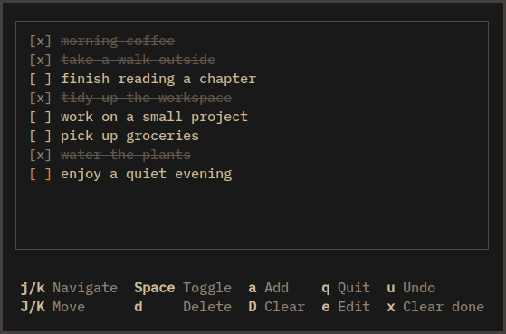

# sati

[](https://github.com/zmeadows/sati/actions/workflows/ci.yml?query=branch%3Amain) [](LICENSE)

> **sati** (Pāli) — mindfulness, recollection; the act of remembering or keeping something in mind.

A small, persistent checklist for the terminal.

<p align="center">Linux · macOS · Windows</p>

<p align="center">
  
</p>

## Why sati?

I wanted a to-do list that felt more like a checklist in a notebook. Calendars, priorities, tags, and reminders can be useful, but I usually don't need them for everyday tasks.

`sati` is for writing things down, checking them off, and clearing the list when the day is over or priorities change.

## Features

- **One local list.** Changes are saved automatically, without accounts or synchronization.
- **Keyboard-first, with mouse support.** Navigate, reorder, and complete tasks from the keyboard. Click a task to toggle it, or scroll with the mouse wheel.
- **Search in place.** Find tasks as you type, see matching text highlighted, and jump to a result without filtering or rearranging the list.
- **Carryover.** Mark unfinished tasks with `m` (`[↪]`) to keep them when clearing the list.
- **Undo and redo.** Up to 256 changes in either direction, with history still available after restarting the program.
- **Display options.** Wrap long tasks, group completed items, and change some style settings with command-line flags.

## Installation

Prebuilt executables are available from [GitHub Releases](https://github.com/zmeadows/sati/releases).
Download and extract the archive for your platform; Rust is not required. Archives
include LICENSE, and SHA-256 checksums are provided in `SHA256SUMS`.

Builds target Linux x86_64 and ARM64 (GNU/glibc, built on Ubuntu 22.04), macOS
Apple Silicon and Intel, and Windows x86_64. Ubuntu 22.04 provides an older glibc
baseline; compatibility with older Linux systems is not guaranteed.

With [Rust and Cargo](https://www.rust-lang.org/tools/install) (Rust 1.88 or newer):

```sh
cargo install --git https://github.com/zmeadows/sati --locked
```

Then run `sati`.

## Keyboard shortcuts

### Checklist

| Action | Keys |
| --- | --- |
| Navigate | `j` / `k`, `↓` / `↑` |
| First / last task | `g` / `G`, `Home` / `End` |
| Move one page | `PageDown` / `PageUp` |
| Reorder task | `J` / `K`, `Shift+↓` / `Shift+↑` |
| Append task | `a` |
| Insert below selection | `o` |
| Insert above selection | `O` |
| Edit task | `e` |
| Check / uncheck | `Space`, `Enter` |
| Delete task | `d`, `Delete` |
| Toggle carryover | `m` |
| Clear completed | `x` |
| Clear unmarked tasks (preserve carried) | `D` |
| Undo | `u`, `Ctrl+Z` |
| Redo | `Ctrl+R`, `Ctrl+Y` |
| Search | `/`, `Ctrl+F` |
| Toggle wrapping | `w` |
| Quit | `q` |

With `--completed-at-bottom`, new tasks stay in the incomplete section.

### While typing

The add, edit, and search prompts share these shortcuts:

| Action | Keys |
| --- | --- |
| Move cursor | `←` / `→` |
| Start / end of text | `Home` / `End`, `Ctrl+A` / `Ctrl+E` |
| Previous / next word | `Ctrl+←` / `Ctrl+→` |
| Delete previous word | `Ctrl+Backspace` |

**Search:** Press `/` and type to find matches. Press `Enter` to browse them, use `n` / `N` or `↓` / `↑` to move between results, then `Enter` to select one. `Esc` cancels and restores your previous selection.

## Options

| Flag | Effect |
| --- | --- |
| `--no-wrap` | Keep each task on one row. |
| `--no-logo` | Hide the title in the border. |
| `--no-keybinds` | Hide the shortcut hints. |
| `--round-corners` | Use rounded borders. |
| `--ascii-markers` | Use `>`, `[x]`, and `[>]` as compatibility fallbacks for task markers. |
| `--completed-at-bottom` | Keep completed tasks below unfinished ones. |
| `--accent '#RRGGBB'` | Set the accent color (default `#e78a4e`). |

Task markers default to `›`, `[ ]`, `[✓]`, and `[↪]`. `--ascii-markers` changes only task markers; other UI symbols remain Unicode.

Run `sati --help` for the full command-line help.

## Data

Tasks are saved locally in `tasks.json`:

| Platform | Location |
| --- | --- |
| Linux | `~/.local/share/sati/tasks.json` (or `$XDG_DATA_HOME/sati/tasks.json`) |
| macOS | `~/Library/Application Support/sati/tasks.json` |
| Windows | `%APPDATA%\sati\tasks.json` |

Undo/redo history is saved separately in `history.json` when you quit normally. If that history is missing or no longer matches your tasks, `sati` starts with an empty history; your saved tasks are unaffected.

## Credits

Inspired by [Meowdo](https://github.com/Sycorlax/Meowdo). Built with [Ratatui](https://ratatui.rs).

## License

[MIT](LICENSE).
