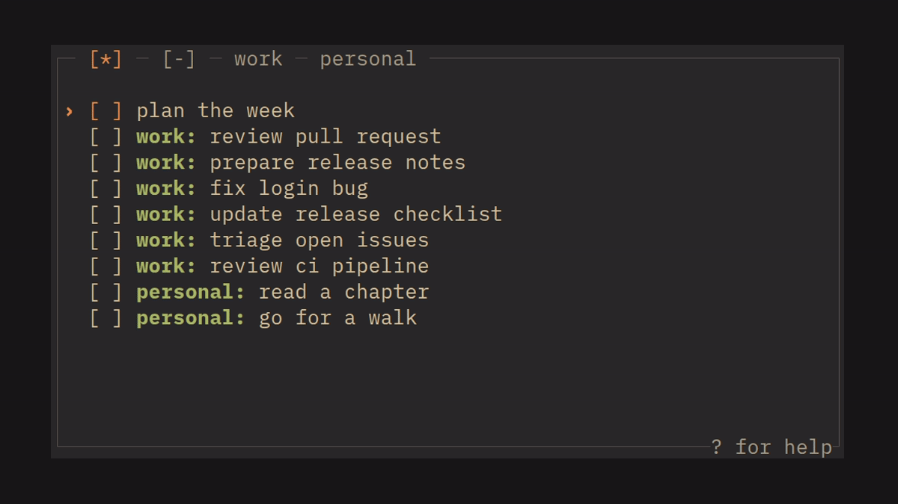

# sati

[](https://github.com/zmeadows/sati/actions/workflows/ci.yml?query=branch%3Amain) [](LICENSE)

A small, persistent checklist for the terminal on Linux, macOS, and Windows.

> **sati** (Pāli) — mindfulness, recollection; the act of remembering or keeping something in mind.

<p align="center">
  
</p>

## Why sati?

I wanted a to-do list that felt more like a checklist in a notebook. Calendars, priorities, tags, and reminders can be useful, but I rarely need them for everyday tasks.

sati is for writing things down, checking them off, and clearing the list when the day is over or priorities change. I keep it running in a dedicated terminal that my window manager shows and hides with one key. At the end of the day, I clear the list and carry over the few unfinished tasks that still matter.

## Features

- One local list, saved automatically. No accounts or synchronization.
- Vim-style keys, with Emacs-style alternatives for many actions.
- Sections: prefix a task with `Work: ` to group it under its own tab.
- Carryover: mark unfinished tasks to keep them when you clear the list.
- Search that highlights matches without filtering or reordering the list.
- Undo and redo for the current session.
- Terminal-native colors by default, plus built-in themes based on Vim, Neovim, and Emacs color schemes.
- Markdown export to stdout or the clipboard.
- Optional mouse support.

## Installation

Download the archive for your platform from [GitHub Releases](https://github.com/zmeadows/sati/releases), extract it, and put `sati` (or `sati.exe`) on your `PATH`. Builds are provided for Linux (x86_64 and ARM64, glibc), macOS (Apple Silicon and Intel), and Windows (x86_64); `SHA256SUMS` lists their checksums. The macOS and Windows executables are not signed, so Gatekeeper or SmartScreen may warn on first launch.

Or build from source with Rust 1.89 or newer:

```sh
cargo install --git https://github.com/zmeadows/sati --locked
```

## Quick start

Run `sati`, press `a` to add a task, and `Space` to check it off. Some essentials:

| Keys | Action |
| --- | --- |
| `j` / `k` | Next / previous task |
| `a`, `o` / `O` | Append task, add below / above |
| `e` | Edit task |
| `Space` | Check / uncheck |
| `J` / `K` | Move task down / up |
| `m` | Mark for carryover |
| `X` / `D` | Clear completed / clear all but carried |
| `/` | Search |
| `u` / `Ctrl+R` | Undo / redo |
| `?` | Keyboard reference |
| `q` | Quit |

Counts work as in Vim (`5j`, `3K`). Many actions also have Emacs-style bindings, such as `Ctrl+N` / `Ctrl+P` to move and `Alt+W` / `Ctrl+Y` to copy and paste a task, and text prompts use the usual Emacs and shell editing keys. Press `?` for the complete list.

Type `Work: Fix bug` to put a task in a `Work` section; tabs then appear on the top border, and `l` / `h` switch between them. See [Sections](docs/USAGE.md#sections) for jumping to, renaming, and reordering tabs.

At the end of the day, mark what you want to keep with `m` and press `D` to clear the rest of the tab; [Carryover and clearing](docs/USAGE.md#carryover-and-clearing) explains the details.

Every change is saved immediately. To keep separate checklists, such as one for work, use `--data-dir`; see [Data and multiple checklists](docs/USAGE.md#data-and-multiple-checklists). Run `sati --help` for all command-line options.

## Configuration

Configuration is optional. sati reads `config.toml` at startup from `~/.config/sati/` on Linux, `~/Library/Application Support/sati/` on macOS, or `%APPDATA%\sati\` on Windows. Command-line options override it.

```toml
theme = "catppuccin-mocha"

[display]
wrap = false
border_style = "rounded"

[input]
mouse = false
```

Run `sati --list-themes` to see the built-in themes, or press `t` / `T` to try them in a running session. The [configuration reference](docs/CONFIGURATION.md) describes every setting, theme selection, and custom colors, and [`docs/config_defaults.toml`](docs/config_defaults.toml) lists every option at its default.

## Export

`sati export` prints the checklist as Markdown, and works while sati is running:

```sh
sati export > tasks.md
sati export work            # only the Work section
sati export --unsectioned   # only tasks without a section
```

In the checklist, `c` copies the current tab as Markdown through the terminal. If your terminal doesn't support that, see [Export and clipboard](docs/USAGE.md#export-and-clipboard).

## Documentation

- [Usage guide](docs/USAGE.md): sections, carryover, data storage, export, and terminal notes.
- [Configuration reference](docs/CONFIGURATION.md): settings, themes, and styles.
- `?` in sati: the complete keyboard reference.
- `sati --help`: command-line options.

## Credits

Inspired by [Meowdo](https://github.com/Sycorlax/Meowdo). Built with [Ratatui](https://ratatui.rs).

## License

[MIT](LICENSE)
